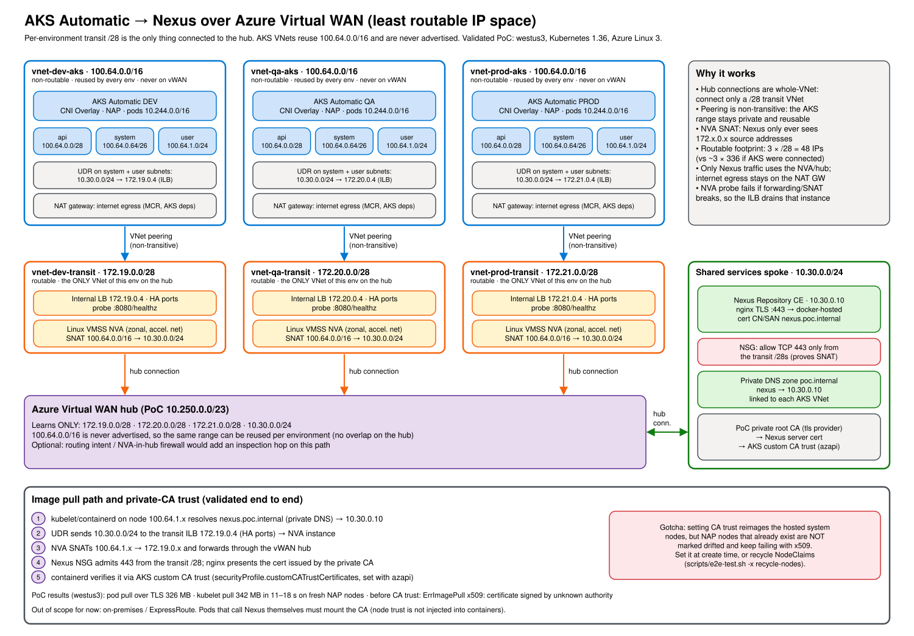

# AKS Automatic → Nexus over Azure Virtual WAN (least routable IP space)

Constraints this design solves for:

- AKS Automatic clusters (DEV / QA / PROD, CNI Overlay, BYO VNet with API `/28`, system `/26`, user `/24`) must pull images from **Nexus**. ACR isn't allowed.
- Nexus lives in a shared spoke that is connected to the **vWAN hub**. AKS → Nexus traffic **must transit the hub**.
- Consume as little routable IP space as possible.

On-premises access is out of scope for now.

## Why the original subnet-peering PoC can't be used as-is with vWAN

The repository root peers a single `/28` subnet with **subnet peering**. A vWAN hub connection is always a **whole-VNet** connection, so subnet peering isn't available toward a hub. Connecting the AKS VNet would therefore advertise its entire address space, including the AKS subnets, to the hub (and on to ExpressRoute). If several environments reuse the same non-routable range, you also end up with overlapping VNet connections on one hub, which isn't supported.

## Design: per-environment transit VNet



Editable source: [`docs/architecture.excalidraw`](docs/architecture.excalidraw) (open in Excalidraw).

<details><summary>Text version</summary>

```
                      +--------------------------- vWAN hub ---------------------------+
                      |  learns ONLY: 172.19.0.0/28, 172.20.0.0/28, 172.21.0.0/28,     |
                      |               Nexus spoke prefix                               |
                      +-------^------------------^------------------^---------^--------+
                  hub conn    |       hub conn   |       hub conn   |         | hub conn
              +---------------+--+  +------------+-----+  +---------+--------+  +-----+-----------------+
              | vnet-dev-transit |  | vnet-qa-transit  |  | vnet-prod-transit|  | AKS Shared Infra      |
              | 172.19.0.0/28    |  | 172.20.0.0/28    |  | 172.21.0.0/28    |  | (Nexus)               |
              | ILB .4 (HA ports)|  | ILB .4           |  | ILB .4           |  | NSG: allow only the   |
              | VMSS SNAT NVA    |  | VMSS SNAT NVA    |  | VMSS SNAT NVA    |  | transit /28s          |
              +--------^---------+  +--------^---------+  +--------^---------+  +-----------------------+
                VNet peering           VNet peering          VNet peering
              +--------+---------+  +--------+---------+  +--------+---------+
              | vnet-dev-aks     |  | vnet-qa-aks      |  | vnet-prod-aks    |
              | 100.64.0.0/16    |  | 100.64.0.0/16    |  | 100.64.0.0/16    |   <- same range, never on vWAN
              | api /28 sys /26  |  | api /28 sys /26  |  | api /28 sys /26  |
              | user /24         |  | user /24         |  | user /24         |
              | UDR: Nexus -> .4 |  | UDR: Nexus -> .4 |  | UDR: Nexus -> .4 |
              +------------------+  +------------------+  +------------------+
```

</details>

1. **Only the transit VNet is connected to the hub.** The hub learns one `/28` per environment.
2. **The AKS VNet is peered only to its own transit VNet.** Peering is non-transitive, so the hub never learns `100.64.0.0/16`, and every environment can reuse it.
3. **A UDR on the AKS node subnets** sends the Nexus prefix to the transit NVA's internal LB (HA ports).
4. **The NVA (Linux VMSS) SNATs** node traffic (`100.64.0.0/16 → Nexus`) to its own transit IP. Nexus replies to a routable transit address through the hub.
5. AKS internet egress (MCR, AKS dependencies) stays on a NAT gateway, so only Nexus traffic uses this path.

**Routable footprint:** 3 × `/28` = 48 addresses, instead of about 3 × 336 if the AKS subnets were hub-connected.

## What's in this folder

| File | Purpose |
|---|---|
| `main.tf` | Resource group, PoC vWAN + hub (or `existing_virtual_hub_id`), Nexus stand-in spoke + VM, one `aks-env` module per environment |
| `modules/aks-env/` | Transit VNet + hub connection, AKS VNet + peering, UDR, NAT gateway, ILB + SNAT VMSS, AKS Automatic cluster, custom CA trust (`azapi_update_resource`) |
| `modules/aks-env/nva-cloud-init.yaml.tftpl` | IP forwarding, scoped `MASQUERADE`, HTTP `/healthz` probe that fails if forwarding or SNAT is missing |
| `nexus-cloud-init.yaml.tftpl` | Nexus Community Edition in Docker. Ports 8081/8082 are bound to localhost; nginx terminates TLS on 443 with a cert from the PoC private CA (`/v2/` → `docker-hosted` connector) |
| `k8s/nexus-pull-test.yaml.tftpl` | Job: crane logs in to Nexus over TLS (trusting `ca.crt` through `SSL_CERT_FILE`), pushes a seed image through the path, pulls it back, prints MB/s |
| `k8s/kubelet-pull-test.yaml.tftpl` | Pod that the **kubelet/containerd** pulls from Nexus using `imagePullSecrets`. This is the custom CA trust test |
| `scripts/e2e-test.sh` | End-to-end test: hub routes, NVA health, CA trust, pod pull, kubelet pull (recycles NAP nodes on x509) |
| `docs/architecture.{svg,excalidraw}` | Architecture diagram |
| `terraform.tfvars.example` | All three environments on an existing hub, all reusing `100.64.0.0/16` |

By default only `dev` is deployed in `westus3`, along with a new PoC hub and a Nexus stand-in VM. The NVA uses `Standard_D2s_v4` and Nexus uses `Standard_D4s_v4`, because DSv5 isn't offered to every subscription in West US 2/3.

Terraform also creates:
- A private root CA (`tls` provider). Its certificate is written to `./ca.crt`.
- A Nexus server cert for `nexus.poc.internal`.
- A private DNS zone `poc.internal` linked to each AKS VNet.
- **AKS custom CA trust** with the private root CA on every cluster (`enable_custom_ca_trust`, default `true`). `azurerm_kubernetes_automatic_cluster` doesn't expose it, so `azapi_update_resource` merges `securityProfile.customCATrustCertificates` (base64 of the PEM) into the cluster.

## Deploy and test

```bash
cd vwan-nexus
terraform init
terraform apply                      # optionally: -var-file=terraform.tfvars

./scripts/e2e-test.sh -x all         # ENV_NAME=qa|prod for other environments
```

`scripts/e2e-test.sh` reads everything it needs from `terraform output` and fails on the first broken invariant:

| Verb | Asserts |
|---|---|
| `setup` | Fetches a kubeconfig (`.kubeconfig-<env>`, gitignored). Creates `nexus-cred`, `nexus-pull` (dockerconfigjson) and the `nexus-ca` configmap. The password only travels through pipes, never argv |
| `routing` | Hub effective routes: the transit connection gets `10.30.0.0/24`, the Nexus connection gets the transit `/28`, and `100.64.0.0/16` appears on **neither** |
| `nva` | ILB `DipAvailability` is 100%. The probe fails if forwarding or SNAT is broken |
| `ca-trust` | The private CA is present in `securityProfile.customCATrustCertificates` |
| `pod-pull` | crane Job over TLS (`SSL_CERT_FILE` = private CA): pushes a seed image through the path, pulls it back, prints throughput |
| `kubelet-pull` | containerd pulls `nexus.poc.internal/poc/seed:1` with `imagePullSecrets`. On `x509` (a NAP node that predates CA trust) it recycles NAP NodeClaims and retries; `RECYCLE_NODES=false` disables that |
| `recycle-nodes` | Deletes all NAP NodeClaims (graceful drain). NAP provisions replacements with the current node config |

The Nexus VM's NSG admits only 443 from the transit `/28`s. A successful pull therefore proves that traffic was SNAT'd by the transit NVA and crossed the vWAN hub.

### PoC results (westus3, AKS Automatic, Kubernetes 1.36, Azure Linux 3)

| Test | Result |
|---|---|
| Hub effective routes | `conn-dev-transit` gets only `10.30.0.0/24`; `conn-shared-nexus` gets only `172.19.0.0/28`. `100.64.0.0/16` is never advertised |
| NVA backends | 100% healthy (zonal VMSS, 2 instances) |
| Pod → Nexus over TLS with private CA (crane) | OK. 325.8 MB in 1.06 s ≈ 307 MB/s (2.6 Gbps, single sample) through NVA + hub, node IP 100.64.1.4 |
| Kubelet pull **before** custom CA trust | `ErrImagePull`: `x509: certificate signed by unknown authority` |
| Custom CA trust on AKS Automatic (`az aks update --custom-ca-trust-certificates`, then the same value via `azapi`) | Accepted. ~16 min the first time (hosted system nodes reimaged); re-applying the same value via `azapi` is a no-op (~3 min, no reimage) |
| Kubelet pull after CA trust, on a NAP node that existed before | Still x509. NAP nodes aren't reimaged and aren't marked `Drifted` |
| Kubelet pull after recycling **all** NAP NodeClaims | OK on fresh nodes. 342 MB pulled and unpacked in 10–18 s |
| Full `e2e-test.sh -x all` | ALL TESTS PASSED |

**Takeaway:** a private CA works for Nexus pulls on AKS Automatic. Set custom CA trust **before** workloads land: this Terraform applies it right after cluster creation. If it is added or rotated later, recycle the NAP NodeClaims (`scripts/e2e-test.sh -x recycle-nodes`). Pods that call Nexus themselves still need the CA mounted, because node trust isn't injected into containers.

## Production notes

- **TLS for kubelet pulls.** containerd on AKS Automatic can't be configured for insecure registries.
  - Expose the Nexus Docker repo over **HTTPS** with a certificate the nodes trust: a public CA, or AKS custom CA trust (validated above on Automatic).
  - The `azurerm_kubernetes_automatic_cluster` resource doesn't expose custom CA trust; this module sets it with `azapi_update_resource` (`securityProfile.customCATrustCertificates`, base64 of each PEM, at most 10 certs, LF line endings). Rotating the CA reimages hosted system nodes; recycle NAP NodeClaims afterwards.
  - Prefer Nexus path-based routing or a dedicated hostname over per-repo connector ports.
- **Pull authentication.** Nexus credentials go in `imagePullSecrets` (or a default ServiceAccount patch per namespace). There's no managed-identity pull as with ACR.
- **Throughput.** Every image byte crosses the NVA and the hub. Size the path for burst scale-outs where many new nodes pull at once.
  - **Hub routing infrastructure units:** the default 2 units give about 3 Gbps aggregate for VNet-to-VNet traffic. Raise them if needed.
  - **NVA:** use a D/F-series SKU with accelerated networking. Avoid B-series. Use the instance count and scale-out to add capacity.
  - **Nexus:** run it HA with a blob store sized for concurrent reads.
  - **Pod spec:** use `imagePullPolicy: IfNotPresent` and keep images small. Artifact Streaming is ACR-only.
- **Hub routing intent / Check Point.** If private-traffic routing intent is enabled on the hub, transit-to-Nexus traffic is also inspected by the hub firewall. That adds a hop and its throughput limit, and the firewall must allow the transit `/28`s to reach Nexus.
- **CIDR hygiene.** The Nexus and hub prefixes must not overlap the AKS VNet range or the cluster's overlay pod and service CIDRs (defaults `10.244.0.0/16` and `10.0.0.0/16`).
- **Alternatives:**
  - **Azure Firewall** in each transit VNet with SNAT set to *always* (private ranges `255.255.255.255/32`). It's managed and HA, with no VMs to patch, but needs a routable `/26` per environment and costs more.
  - **Private Link service Direct Connect** (preview). It's a private endpoint in the AKS VNet with a PLS DC in the transit VNet targeting the Nexus IP. It's native SNAT with no UDRs, but it's preview-only and reaching Nexus through the hub is unvalidated.
